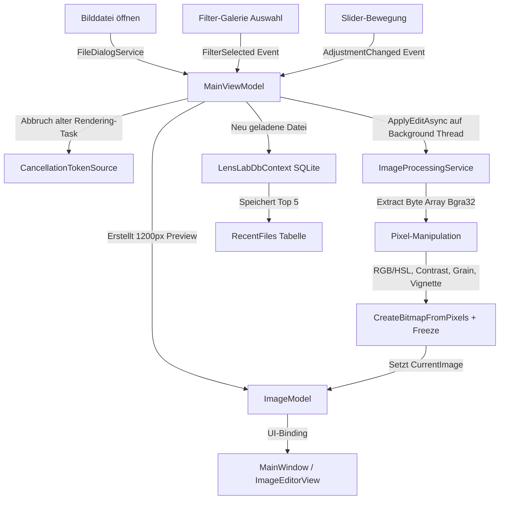

# LensLab – Ausführlicher Kolloquium- & Architektur-Leitfaden

Dieser Leitfaden ist dein kompletter Vorbereitungs-Spickzettel für das Kolloquium. Er erklärt nicht nur, **WAS** im Code passiert, sondern vor allem **WARUM** wir uns für bestimmte Architektur-Muster, Algorithmen und Datenstrukturen entschieden haben.

---

## Inhaltsverzeichnis
1. [Die Architektur-Philosophie & Entwurfsentscheidungen](#1-die-architektur-philosophie--entwurfsentscheidungen)
2. [MVVM & Externe Bibliotheken (NuGet)](#2-mvvm--externe-bibliotheken-nuget)
3. [Detaillierte Analyse aller Dateien (Datei für Datei)](#3-detaillierte-analyse-aller-dateien-datei-für-datei)
   - [Models (Datenstrukturen)](#models-datenstrukturen)
   - [Services (Geschäfts- & Bildlogik)](#services-geschäfts--bildlogik)
   - [ViewModels (Zustand & Steuerung)](#viewmodels-zustand--steuerung)
   - [Views & UI (XAML & Styling)](#views--ui-xaml--styling)
   - [Data & Datenbank (EF Core + SQLite)](#data--datenbank-ef-core--sqlite)
   - [Converters (UI-Hilfsklassen)](#converters-ui-hilfsklassen)
4. [Mathematische Algorithmen der Bildverarbeitung](#4-mathematische-algorithmen-der-bildverarbeitung)
5. [Prüfungsfragen & Perfekte Antworten für den Professor](#5-prüfungsfragen--perfekte-antworten-für-den-professor)

---

## 1. Die Architektur-Philosophie & Entwurfsentscheidungen

### Warum .NET 8 & WPF?
* **WPF (Windows Presentation Foundation):** Bietet eine extrem mächtige XAML-Engine mit flexiblem Data-Binding, Vektorgrafiken und Hardwareressourcen-Optimierung.
* **.NET 8 LTS:** Bietet die modernste C#-Syntax, performante `System.Text.Json`-Serialisierung und erstklassige asynchrone Sprachkonzepte (`async/await`, `Task.Run`, `ValueTask`).

### Wie der Datenfluss in LensLab funktioniert:

### Die 3 goldenen Architektur-Regeln von LensLab:

1. **Zwei-Stufen-Bildspeicherung (Original vs. Preview):**
   - **Problem:** Ein Smartphone-Foto hat z. B. 4000×3000 Pixel (12 Megapixel = 48 Megabyte unkomprimierte Pixeldaten). Jedes Verschieben eines Sliders würde 12 Millionen Pixel neu berechnen. Das führt zu unbrauchbarem Ruckeln (1-2 FPS).
   - **Lösung:** Beim Laden wird das hochauflösende Original (`OriginalImage`) im Speicher behalten. Für die Live-Vorschau wird eine herunterskalierte Variante (`PreviewImage` mit max. 1200 Pixeln Kantenlänge) erzeugt. Slider-Änderungen berechnen **nur** diese kleine Vorschau (ca. 60 FPS!). Erst beim **Export** wird die gesamte Pixel-Kette auf das `OriginalImage` angewendet.

2. **Non-Blocking UI & Thread-Sicherheit:**
   - Der UI-Thread (Haupt-Thread) darf **niemals** mit Rechenarbeit belastet werden, da das Fenster sonst einfriert ("Keine Rückmeldung").
   - Alle Pixel-Berechnungen laufen auf Hintergrund-Threads (`Task.Run`).
   - WPF erlaubt es normalen Objekten nicht, zwischen Threads zu wechseln. Deshalb wenden wir auf jedes erzeugte `BitmapSource`-Objekt die Methode `.Freeze()` an. Das friert das Bild ein (macht es unveränderlich / read-only) und schaltet es für alle Threads frei.

3. **Debouncing & Cancellation Token (Interrupt-basiertes Rendering):**
   - Wenn der Benutzer einen Slider z. B. in 1 Sekunde von 0 auf 50 zieht, löst WPF etwa 30 `PropertyChanged`-Events aus.
   - Um den Hauptspeicher nicht mit veralteten Render-Jobs zu überlasten, hält das `MainViewModel` ein `CancellationTokenSource`.
   - Bei jeder Bewegung gilt: `_renderCts?.Cancel()`. Der vorherige Render-Task wird sofort abgebrochen und verworfen; nur die aktuellste Slider-Position wird berechnet.

---

## 2. MVVM & Externe Bibliotheken (NuGet)

### Das MVVM-Muster in LensLab
* **Model:** Reine Datenobjekte ohne Logik. Beinhaltet ImageModel.cs, FilterPreset.cs, AdjustmentSettings.cs.
* **View:** Reine Benutzeroberfläche in XAML. Weiß nichts von Datenbanken oder Algorithmen. Beispiele: MainWindow.xaml, AdjustmentPanel.xaml.
* **ViewModel:** Das Gehirn der App. Reagiert auf Benutzereingaben, steuert Services, hält den Zustand der App und benachrichtigt die View über Datenänderungen.

### Warum haben wir diese NuGet-Pakete gewählt?

1. **`CommunityToolkit.Mvvm` (Microsoft):**
   - **Warum?** Vermeidet hunderte Zeilen redundanten Boilerplate-Code.
   - **Attribut `[ObservableProperty]`:** Wandelt z.B. `private string _statusText;` automatisch in die Eigenschaft `StatusText` inklusive `INotifyPropertyChanged`-Benachrichtigung um.
   - **Attribut `[RelayCommand]`:** Wandelt eine Methode wie `private async Task OpenImageAsync()` in eine bindbare `ICommand`-Eigenschaft `OpenImageCommand` um.

2. **`MahApps.Metro` & `MahApps.Metro.IconPacks`:**
   - **Warum?** Die Standard-WPF-Fenster sehen wie Windows 7 aus. MahApps verleiht der App ein extrem modernes Dark-Theme ("Metro"-Stil) mit angepassten Titelleisten und Vektor-Icons.

3. **`Microsoft.EntityFrameworkCore.Sqlite`:**
   - **Warum?** Ein relationales ORM (Object-Relational Mapper). Ermöglicht das Speichern von Objekten in eine lokale SQLite-Datenbankdatei (lenslab.db), ohne händisch SQL-Queries schreiben zu müssen.

---

## 3. Detaillierte Analyse aller Dateien (Datei für Datei)

### Models (Datenstrukturen)

#### ImageModel.cs
* **Aufgabe:** Datenbehälter für das geladene Bild.
* **Eigenschaften:**
  - `OriginalImage`: Volle Auflösung (z.B. 4000×3000). Wird nur für den finale Export verwendet.
  - `PreviewImage`: Herunterskalierte Version (max. 1200px Kantenlänge). Dient als Ausgangsbasis für die Live-Vorschau.
  - `CurrentImage`: Das aktuell mit allen Filtern/Slidern manipulierte Bild, das in der View dargestellt wird.
  - `FilePath`, `FileName`, `Width`, `Height`: Metadaten des Bildes.

#### FilterPreset.cs
* **Aufgabe:** Repräsentiert ein analoges Film-Preset.
* **Eigenschaften:**
  - Enthält Eigenschaften wie `Brightness`, `Contrast`, `Saturation`, `Temperature`, `Tint`, `RedMultiplier`, `GreenMultiplier`, `BlueMultiplier`, `Grain`, `Vignette`, `Fade`, `Highlights`, `Shadows`.
  - Enthält zusätzlich 24 HSL-Farbkanal-Offsets (z.B. `HueRed`, `SaturationGreen`, `LuminanceBlue`), um gezielt einzelne Farben anzupassen.
  - Verwendet `[JsonPropertyName("...")]`, um JSON-Schlüssel exakt auf C#-Eigenschaften zu mappen.

#### FilterPreviewItem.cs
* **Aufgabe:** Wrapper-Klasse für die linke Filtergalerie. Erbt von `ObservableObject`.
* **Eigenschaften:** Hält das `FilterPreset`, ein berechnetes `Thumbnail` (BitmapSource) und ein Flag `IsSelected` für den visuellen Auswahlrahmen in der UI.

#### AdjustmentSettings.cs
* **Aufgabe:** Hält die aktuellen manuellen Slider-Positionen des Benutzers.
* **Eigenschaften:** Alle Slider-Parameter (`Brightness`, `Contrast` etc.). Besitzt eine Methode `Reset()`, die alle Werte wieder auf `0.0` zurücksetzt.

---

## 4. Mathematische Algorithmen der Bildverarbeitung

Falls der Professor nach den konkreten Bildverarbeitungs-Formeln fragt:

1. **Bgra32 Byte-Array Struktur:**
   Jedes Pixel besteht aus 4 aufeinanderfolgenden Bytes im Array:
   `pixels[i]` = Blau, `pixels[i+1]` = Grün, `pixels[i+2]` = Rot, `pixels[i+3]` = Alpha.

2. **Kontrast-Formel (`ApplyContrast`):**
   $$\text{factor} = \frac{259 \cdot (\text{contrast} + 255)}{255 \cdot (259 - \text{contrast})}$$
   $$\text{Pixel}_{\text{neu}} = \text{factor} \cdot (\text{Pixel}_{\text{alt}} - 128) + 128$$

3. **Vignette-Formel (`ApplyVignette`):**
   Berechnet den quadratischen Abstand vom Bildmittelpunkt $(cx, cy)$:
   $$\text{distSq} = \frac{(x - cx)^2 + (y - cy)^2}{cx^2 + cy^2}$$
   $$\text{factor} = 1.0 - \left(\frac{\text{amount}}{100}\right) \cdot \text{distSq}$$

4. **Film Grain / Rauschen (`ApplyGrain`):**
   Verwendet eine pseudo-zufällige Verteilung mit festem Seed für Reproduzierbarkeit:
   $$\text{noise} = \text{random.NextDouble}() \cdot 2 \cdot \text{amount} - \text{amount}$$
   $$\text{Pixel}_{\text{neu}} = \text{ClampToByte}(\text{Pixel}_{\text{alt}} + \text{noise})$$

5. **Filter Deckkraft-Mischung (Linear Interpolation):**
   $$\text{Pixel}_{\text{Gemischt}} = \text{Original} \cdot (1.0 - \text{blend}) + \text{Gefiltert} \cdot \text{blend} \quad \text{mit } \text{blend} = \frac{\text{opacity}}{100}$$

---

## 5. Prüfungsfragen & Perfekte Antworten für den Professor

### Q1: *"Wie ist Ihr Projekt strukturiert und warum haben Sie MVVM gewählt?"*
> **Antwort:** *"LensLab ist nach dem MVVM-Muster aufgebaut. Die Geschäftslogik und Pixel-Verarbeitung befinden sich in entkoppelten Services (`ImageProcessingService`, `FilterLoaderService`). Das `MainViewModel` verwaltet den Zustand der Anwendung und orchestriert die Teilsysteme. Die Views bestehen aus wiederverwendbaren UserControls in XAML. MVVM wurde gewählt, um die Benutzeroberfläche vollständig von der Geschäftslogik zu trennen. Dadurch bleibt der Code sauber, wartbar und für Unit-Tests vorbereitet."*

### Q2: *"Was passiert im Speicher, wenn ich ein 20-Megapixel-Bild lade und an den Slidern drehe?"*
> **Antwort:** *"Um Speicher und CPU zu schonen, nutzen wir eine Zwei-Stufen-Architektur. Das geladene Originalbild wird im `ImageModel` als `OriginalImage` aufbewahrt. Für die UI erstellen wir eine herunterskalierte Arbeitskopie (`PreviewImage` mit max. 1200px Kantenlänge). Alle Slider-Anpassungen berechnen in Echtzeit nur diese kleine Vorschau. Erst beim finale Export wenden wir dieselbe Berechnungs-Pipeline asynchron auf das volle Originalbild an."*

### Q3: *"Warum nutzen Sie `.Freeze()` auf Ihren BitmapSource-Objekten?"*
> **Antwort:** *"WPF-Bitmaps sind standardmäßig veränderbar (mutable) und an den Thread gebunden, auf dem sie erstellt wurden. Da unsere Bildverarbeitung auf Hintergrund-Threads via `Task.Run` läuft, würde WPF beim Anzeigen in der UI eine Thread-Access-Exception werfen. Durch Aufruf von `.Freeze()` wird die Bitmap schreibgeschützt (immutable) und somit thread-sicher. Sie kann danach gefahrlos an den UI-Thread übergeben werden."*

### Q4: *"Wie verhindern Sie, dass die App einfriert oder ruckelt, wenn man Slider schnell bewegt?"*
> **Antwort:** *"Erstens läuft die Pixel-Berechnung vollständig asynchron im Hintergrund. Zweitens nutzen wir ein Debouncing-Konzept mit `CancellationTokenSource`. Bei jeder neuen Slider-Bewegung wird ein laufender Render-Task über `_renderCts?.Cancel()` abgebrochen. Es wird immer nur der allerneueste Zustand berechnet, wodurch sich veraltete Render-Jobs nicht aufstauen."*

### Q5: *"Warum haben Sie System.Text.Json und SQLite / EF Core verwendet?"*
> **Antwort:** *"System.Text.Json ist die moderne, in .NET 8 fest integrierte Hochleistungs-Bibliothek zur Serialisierung. Wir nutzen sie für das dateibasierte Speichern und Laden der analogen Film-Presets (`.json`). SQLite mit EF Core setzen wir ein, um strukturierte Anwendungsdaten wie die zuletzt geöffneten Dateien persistent in einer lokalen Datenbank (`lenslab.db`) zu verwalten – komplett ohne externe Datenbank-Server-Installation."*
